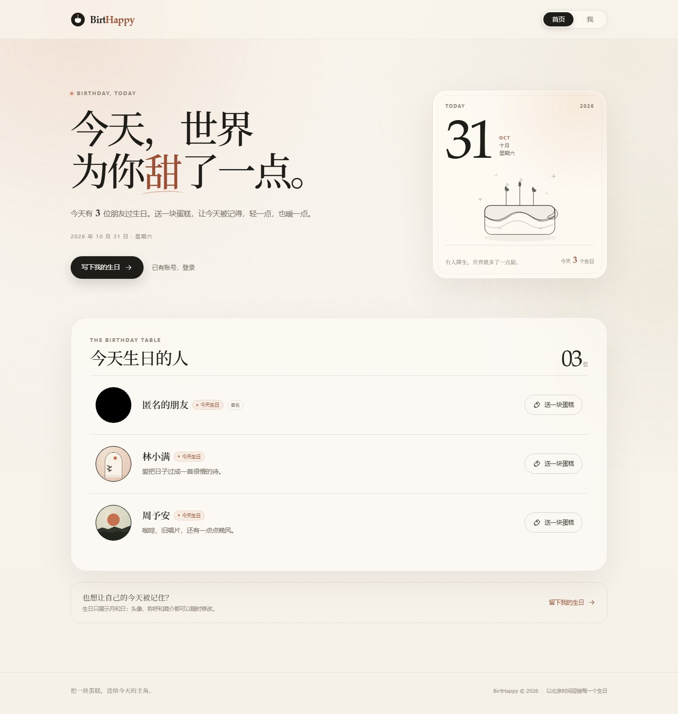
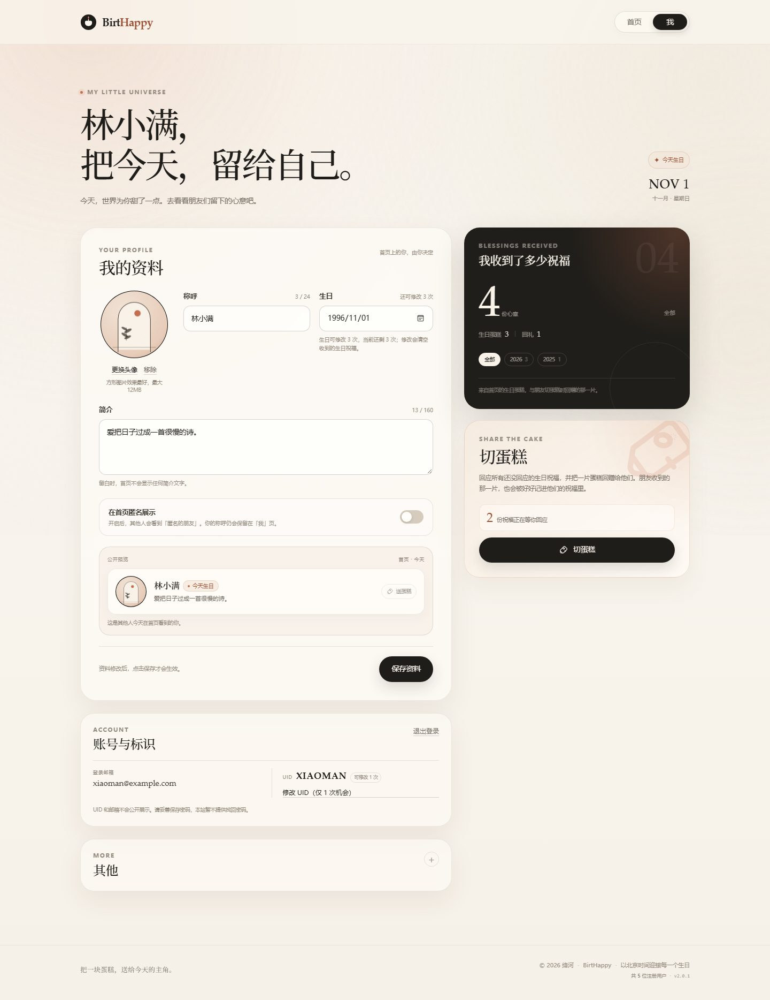
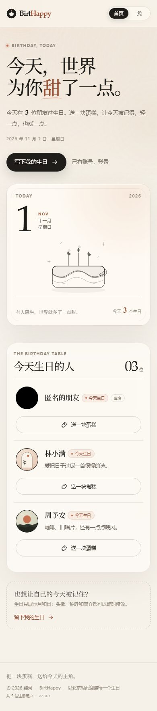

# BirtHappy

> 今天，世界为你甜了一点。

BirtHappy 是一个只展示「今天过生日的人」的轻量生日祝福网站。没有评论区，没有排行榜，只有一张今日生日桌、一块蛋糕，以及一份被记住的心意。



## 已实现功能

- **首页**：只展示今天（北京时间）过生日的注册用户，列表包含头像、公开称呼、非空简介和「送一块蛋糕」按钮。
- **送蛋糕**：登录用户对同一位朋友每年最多送一次，重复请求幂等；不能给自己送；服务端校验今天是否真的是对方生日。
- **「我」页**：编辑头像、称呼、简介、生日，切换匿名展示，实时预览首页上的公开卡片。
- **匿名**：只影响首页公开称呼，显示为「匿名的朋友」；「我」页仍保留并展示真实称呼。
- **纯黑默认头像**：没有上传头像时显示纯黑圆形；简介为空时首页完全不渲染简介区域。
- **切蛋糕**：一次性回应所有尚未回应的祝福，并给每位祝福者回赠一块蛋糕；回礼会记入对方的「收到祝福」。
- **祝福统计**：总览收到的全部祝福，支持按自然年细分，同时区分生日蛋糕与回礼。
- **完整账号体系**：注册、登录、退出；bcrypt 密码哈希、HttpOnly 签名 Cookie、同源校验、参数化 SQL。
- **视觉与响应式**：奶油白与炭黑配色、中文衬线标题、轻柔动效、移动端适配、键盘焦点与减少动态效果支持。
- **零对象存储**：头像在浏览器端裁切压缩，存入数据库，由专用缓存接口返回。
- **零配置本地开发**：默认使用本地 SQLite 文件，生产切换 Turso 即可。
- **自动建表**：首次请求幂等初始化数据库，无需手工执行 SQL。



<p>
  
</p>

## 技术栈

| 层 | 选型 |
| --- | --- |
| 框架 | Next.js 15 App Router + React 19 + TypeScript |
| 样式 | 原生 CSS（`src/app/globals.css`），无 UI 框架 |
| 数据库 | libSQL / SQLite，生产使用 Turso |
| 鉴权 | jose JWT + HttpOnly Cookie，bcryptjs 密码哈希 |
| 部署 | Vercel / Netlify 免费额度 + Turso 免费额度 |

## 本地启动

要求 Node.js **20.9 或更高版本**（推荐 22 LTS）。

```bash
npm install
npm run dev
```

打开 <http://localhost:3000>。首次访问会自动创建 `data/birthhappy.db`。

### 载入演示数据（可选）

```bash
npm run seed
```

会写入 5 个本地区域演示账号，统一密码为 `birthhappy123`：

| 账号 | 角色 |
| --- | --- |
| `xiaoman` | 今天生日，有 4 份历史祝福、2 份待回应，可体验切蛋糕 |
| `yuan` | 今天生日，有头像 |
| `acheng` | 今天生日，匿名、无头像、简介为空，用于验证边界展示 |
| `zhiyao` | 非今日生日，可用于给他人送蛋糕 |
| `nan` | 非今日生日 |

> `seed` 默认只会写入 `file:` 本地数据库；若目标是远程数据库，脚本会拒绝执行。请勿把演示数据写入正式环境。

### 环境变量

本地开发不需要环境变量。生产环境参考 [.env.example](.env.example)：

| 变量 | 必填 | 说明 |
| --- | --- | --- |
| `TURSO_DATABASE_URL` | 生产必填 | Turso 数据库 URL，例如 `libsql://xxx.turso.io` |
| `TURSO_AUTH_TOKEN` | 生产必填 | Turso 数据库访问令牌 |
| `AUTH_SECRET` | 生产必填 | 至少 32 位随机字符串，用于签名登录 Cookie；缺失时无法签发会话 |
| `AUTH_COOKIE_SECURE` | 否 | 仅供本机用 HTTP 跑生产构建时设为 `false`；线上不要设置 |

## 常用命令

```bash
npm run dev      # 开发服务器
npm run build    # 生产构建（含类型检查）
npm run start    # 启动已构建的生产服务
npm run seed     # 载入本地演示数据
```

## 核心规则

- 所有「今天」均按 **Asia/Shanghai（北京时间）** 判断。
- 生日只按「月-日」匹配；年份不公开、不展示年龄。
- 2 月 29 日生日在非闰年的 2 月 28 日展示和庆祝。
- 生日用户本人会从自己的首页列表中排除，避免给自己送蛋糕。
- 同一送礼人对同一收礼人、同一种祝福，每自然年只计一次。
- 切蛋糕可以多次进行：有新祝福时按钮重新可用；没有待回应祝福时禁用。
- 「收到的祝福」= 他人在首页送出的生日蛋糕 + 他人切蛋糕后回赠的蛋糕。
- 游客可以浏览首页，但送蛋糕、切蛋糕与编辑资料必须登录。

完整产品规则与验收条件见 [需求文档](docs/需求文档.md)。

## 目录结构

```text
src/
  app/
    (main)/              # 带主导航的页面：首页、我
    (auth)/              # 登录、注册
    api/                 # 注册/登录/退出、资料、祝福、切蛋糕、头像
    globals.css          # 全站视觉与响应式
  components/            # 导航、列表、表单、统计、切蛋糕、Toast 等
  lib/                   # 数据库、会话、生日规则、校验、数据访问
scripts/
  seed-demo.mjs          # 本地演示数据
  generate-demo-avatars.py
docs/
  需求文档.md
  部署指南.md
  screenshots/
```

## 部署到公网

- 海外访问或已有稳定代理：见 **[Vercel 免费部署指南](docs/部署指南.md)**。
- 国内网络优先：见 **[Netlify 免费部署指南](docs/Netlify部署指南.md)**。

两个平台共用同一个 Turso 数据库。简要流程：

1. 将代码推送到 GitHub。
2. 在 [Turso](https://turso.tech) 创建免费数据库，取得 URL 与 Token。
3. 在 [Netlify](https://app.netlify.com) 或 [Vercel](https://vercel.com/new) 导入仓库。
4. 配置 `TURSO_DATABASE_URL`、`TURSO_AUTH_TOKEN`、`AUTH_SECRET`。
5. 部署完成后访问平台提供的免费域名。

## 已知边界

当前定位是朋友间的小型生日应用，暂不包含：

- 找回密码、修改密码、注销账号。
- 邮箱/手机号与验证码。
- 评论、私信、关注、推送通知。
- 内容审核与举报后台。
- 多时区选择（统一按北京时间）。

如需公开运营，请先补充账号恢复、滥用防护、内容安全与隐私政策。
